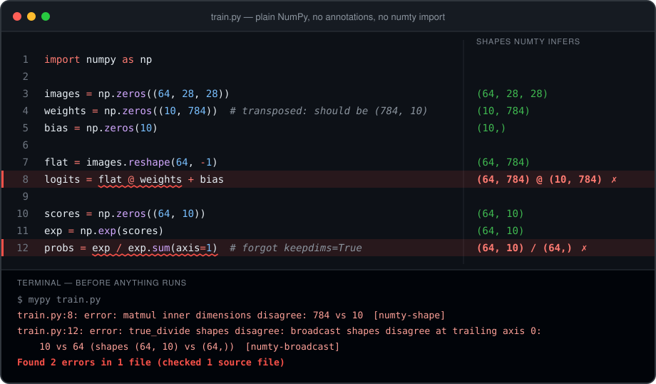

<h1 align="center">numty</h1>

<p align="center">
  <b>Static shape checking for NumPy.</b><br>
  Wrong-shaped arrays become mypy errors, before anything runs.
</p>

<p align="center">
  <a href="https://sofeikov.github.io/numty/"><b>Documentation</b></a> ·
  <a href="https://sofeikov.github.io/numty/get-started/">Get started</a> ·
  <a href="https://sofeikov.github.io/numty/examples/bug-gallery/">Bug gallery</a> ·
  <a href="https://sofeikov.github.io/numty/internals/limitations/">Limitations</a>
</p>

<p align="center">
  <a href="https://github.com/sofeikov/numty/actions/workflows/ci.yml"></a>
  
  
  
</p>

<p align="center">
  
</p>

That file imports nothing from numty and annotates nothing. numty worked
out that `reshape(64, -1)` of `(64, 28, 28)` is `(64, 784)`, carried it
into the `@`, and saw that `sum(axis=1)` drops an axis the division needs.

The second bug is the dangerous kind. With 10 samples instead of 64, NumPy
would broadcast `(10, 10) / (10,)` without complaint and return
probabilities normalised along the wrong axis.

<details>
<summary>The same example as text</summary>

```python
import numpy as np

images = np.zeros((64, 28, 28))
weights = np.zeros((10, 784))  # transposed: should be (784, 10)
bias = np.zeros(10)

flat = images.reshape(64, -1)
logits = flat @ weights + bias

scores = np.zeros((64, 10))
exp = np.exp(scores)
probs = exp / exp.sum(axis=1)  # forgot keepdims=True
```

```text
train.py:8: error: matmul inner dimensions disagree: 784 vs 10  [numty-shape]
train.py:12: error: true_divide shapes disagree: broadcast shapes disagree at trailing axis 0: 10 vs 64 (shapes (64, 10) vs (64,))  [numty-broadcast]
```

</details>

## Name the sizes once and it does the algebra

Write shapes in the signature, [jaxtyping](https://docs.kidger.site/jaxtyping/)
style. Every comment below is the shape numty infers, as a formula over
those names:

```python
import numpy as np
from numpy.lib.stride_tricks import sliding_window_view
from numty import F64, I64

def features(
    signal: F64["batch time"],
    image: F64["batch chan height width"],
    offsets: I64["batch+1"],
) -> None:
    np.diff(signal, axis=1)                     # (batch, time-1)
    np.fft.rfft(signal, axis=1)                 # (batch, time//2+1), complex128
    sliding_window_view(signal, 5, axis=1)      # (batch, time-4, 5)
    np.pad(signal, ((0, 0), (2, 2)))            # (batch, time+4)
    np.concatenate([signal, signal], axis=1)    # (batch, 2*time)
    image.reshape(image.shape[0], -1)           # (batch, chan*height*width)
    np.diff(offsets)                            # (batch,)
    signal[:, 1:] - signal[:, :-1]              # (batch, time-1)
    signal[:, 1:] - signal                      # off by one
```

```text
error: broadcast shapes disagree at trailing axis 0: time-1 vs time (shapes (batch, time-1) vs (batch, time))  [numty-broadcast]
```

`batch`, `time`, `chan`, `height` and `width` are never declared: the
strings mint them. The sizes are unknown until the function is called, and
the off-by-one is still an error, because `time-1` cannot equal `time`
whatever `time` is.

## Why trust it

- **Checked against NumPy itself.** A differential test generates NumPy
  expressions and compares numty's shape and dtype with what NumPy
  returns. The latest long run covered 42,000 expressions with no
  disagreements. [Details](https://sofeikov.github.io/numty/internals/checked-against-numpy/)
- **It finds seeded bugs.** [bench/](bench) hides 18 realistic mistakes in
  MLP-training and math-library code. 17 are reported before anything runs.
- **It runs on real library code.** scikit-learn's Cholesky ridge solver
  is annotated, checks clean, and agrees with scikit-learn's own results.
  [See it](https://sofeikov.github.io/numty/examples/ridge/)
- **Unknown is not an error.** When a size cannot be known statically,
  numty says nothing and keeps checking the dims around it, so
  unannotated code stays quiet.

The examples above are files in [tests/fixtures](tests/fixtures), pinned by
the test suite message for message.

## Install

```sh
pip install "numty @ git+https://github.com/sofeikov/numty" mypy
```

The name `numty` on PyPI belongs to an unrelated project, so install from
GitHub. Then turn the plugin on in `mypy.ini`:

```ini
[mypy]
plugins = numty_plugin
allow_redefinition = True
```

Run `mypy` as usual. Needs Python 3.13+, NumPy 2.5+ and mypy 2.4.

Two different named sizes where one size is needed (`F64[N] + F64[M]`
in a function generic in both) are reported by the `numty-names` code,
which is on by default since
[#327](https://github.com/sofeikov/numty/issues/327). Add
`disable_error_code = numty-names` to turn it off; see
[Error codes](https://sofeikov.github.io/numty/reference/error-codes/).

## Documentation

| | |
|---|---|
| [Get started](https://sofeikov.github.io/numty/get-started/) | Install, configure, first check |
| [Guide](https://sofeikov.github.io/numty/guide/annotations/) | Annotating shapes, named sizes, symbolic arithmetic, unknown dims, indexing |
| [Examples](https://sofeikov.github.io/numty/examples/bug-gallery/) | Bug gallery, attention, sklearn ridge regression, rank-generic helpers |
| [Coming from jaxtyping](https://sofeikov.github.io/numty/jaxtyping/) | The same look, checked statically, with a converter for existing files |
| [Reference](https://sofeikov.github.io/numty/reference/operations/) | Supported operations, error codes, tracing and strict mode |
| [Limitations](https://sofeikov.github.io/numty/internals/limitations/) | Where numty goes quiet, stated plainly |

The docs are built from [docs/](docs) with MkDocs. To preview them locally:

```sh
uv run --only-group docs mkdocs serve
```

## Good to know

The shape solver is a mypy plugin. pyright and ty have no plugin API, so
they get rank and fixed-size checks through plain `ndarray` types, but not
the solver. [How it works](https://sofeikov.github.io/numty/internals/how-it-works/)
explains the layers.

## License

MIT. See [LICENSE](LICENSE) and [LICENSES/](LICENSES) for third-party
excerpts.
