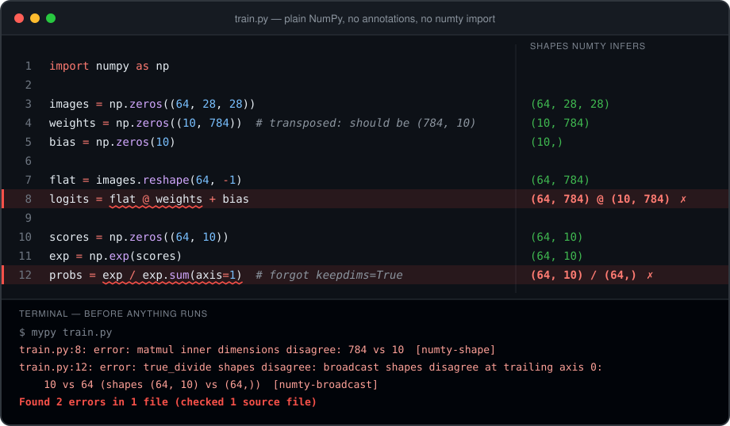

<div class="hero" markdown>

# Shape bugs, caught before anything runs

<p class="lead">
numty is a mypy plugin that knows the shape of every NumPy array in your
code. A transposed matrix or a missing <code>keepdims</code> becomes a type
error on the line that caused it.
</p>

[Get started](get-started.md){ .md-button .md-button--primary }
[Browse the bug gallery](examples/bug-gallery.md){ .md-button }



</div>

## Plain NumPy, no annotations

The file above imports nothing from numty and annotates nothing. Here it
is as text:

```python title="train.py"
import numpy as np

images = np.zeros((64, 28, 28))
weights = np.zeros((10, 784))  # transposed: should be (784, 10)
bias = np.zeros(10)

flat = images.reshape(64, -1)
logits = flat @ weights + bias

scores = np.zeros((64, 10))
exp = np.exp(scores)
probs = exp / exp.sum(axis=1)  # forgot keepdims=True
```

```text
train.py:8: error: matmul inner dimensions disagree: 784 vs 10  [numty-shape]
train.py:12: error: true_divide shapes disagree: broadcast shapes disagree at trailing axis 0: 10 vs 64 (shapes (64, 10) vs (64,))  [numty-broadcast]
```

mypy reports both without executing a line. numty worked out that
`reshape(64, -1)` of `(64, 28, 28)` is `(64, 784)`, carried that into the
`@`, and saw that `sum(axis=1)` drops an axis the division needs.

!!! danger "The second bug is the dangerous kind"

    With 10 samples instead of 64, NumPy would broadcast `(10, 10) / (10,)`
    without complaint and return probabilities normalised along the wrong
    axis. No exception, no warning, wrong numbers.

## Name the sizes once and it does the algebra

One signature, no annotations in the body. Every comment is the shape
numty infers, as a formula over the names in the signature:

```python
import numpy as np
from numpy.lib.stride_tricks import sliding_window_view
from numty import F64, I64

def features(
    signal: F64["batch time"],
    image: F64["batch chan height width"],
    offsets: I64["batch+1"],
) -> None:
    np.diff(signal, axis=1)                     # (batch, time-1)
    np.fft.rfft(signal, axis=1)                 # (batch, time//2+1), complex128
    sliding_window_view(signal, 5, axis=1)      # (batch, time-4, 5)
    np.pad(signal, ((0, 0), (2, 2)))            # (batch, time+4)
    np.concatenate([signal, signal], axis=1)    # (batch, 2*time)
    image.reshape(image.shape[0], -1)           # (batch, chan*height*width)
    np.diff(offsets)                            # (batch,)
    signal[:, 1:] - signal[:, :-1]              # (batch, time-1)
    signal[:, 1:] - signal                      # off by one
```

```text
error: broadcast shapes disagree at trailing axis 0: time-1 vs time (shapes (batch, time-1) vs (batch, time))  [numty-broadcast]
```

`batch`, `time`, `chan`, `height` and `width` are never declared: the
strings mint them. The sizes are unknown until the function is called,
and the off-by-one on the last line is still an error, because `time-1`
cannot equal `time` whatever `time` is.

## A whole attention block from one signature

```python
import numpy as np
from numty import F32

def attention(
    q: F32["batch heads seq dim"],
    k: F32["batch heads seq dim"],
    v: F32["batch heads seq dim"],
) -> F32["batch heads seq dim"]:
    scores = q @ k.swapaxes(-1, -2)            # (batch, heads, seq, seq)
    scores = scores - scores.max(axis=-1, keepdims=True)
    weights = np.exp(scores)
    weights = weights / weights.sum(axis=-1, keepdims=True)
    return weights @ v
```

```text
Success: no issues found in 1 source file
```

Four symbolic dims through a batched matmul, a transpose, two keepdims
reductions and two broadcasts, with the return checked against the
signature. Drop the `@ v` and return the weights by mistake, and the two
shapes are named side by side:

```text
error: Incompatible return value type (got "ndarray[tuple[batch, heads, seq, seq], dtype[floating[_32Bit]]]", expected "ndarray[tuple[batch, heads, seq, dim], dtype[floating[_32Bit]]]")  [return-value]
```

## Why trust it

<div class="grid cards" markdown>

-   :material-scale-balance: **Checked against NumPy itself**

    ---

    A differential test generates NumPy expressions and compares numty's
    answer with what NumPy returns. The latest long run covered 42,000
    expressions with no disagreements.

    [How the oracle works](internals/checked-against-numpy.md)

-   :material-bug-check: **It finds seeded bugs**

    ---

    The benchmark hides 18 realistic mistakes in MLP-training and
    math-library code. 17 are reported before anything runs.

    [Bug gallery](examples/bug-gallery.md)

-   :material-library: **It runs on real library code**

    ---

    scikit-learn's Cholesky ridge solver is annotated, checks clean, and
    agrees with scikit-learn's own results in the test suite.

    [Ridge regression](examples/ridge.md)

-   :material-volume-off: **Unknown is not an error**

    ---

    When a size cannot be known statically numty says nothing and keeps
    checking the dims around it, so unannotated code stays quiet.

    [Limitations, stated plainly](internals/limitations.md)

</div>

Every example on this page is a file in
[tests/fixtures](https://github.com/sofeikov/numty/tree/main/tests/fixtures)
and is pinned by the test suite, message for message.

## Where next

<div class="grid cards" markdown>

-   :material-rocket-launch: **[Get started](get-started.md)**

    Install, add two lines to `mypy.ini`, run mypy.

-   :material-book-open-variant: **[Guide](guide/annotations.md)**

    Annotating shapes, named sizes, symbolic arithmetic, unknown dims,
    indexing.

-   :material-swap-horizontal: **[Coming from jaxtyping](jaxtyping.md)**

    The same look, checked statically. A converter rewrites existing files.

-   :material-format-list-checks: **[Reference](reference/operations.md)**

    Every supported operation, the nine error codes, tracing and strict
    mode.

</div>
